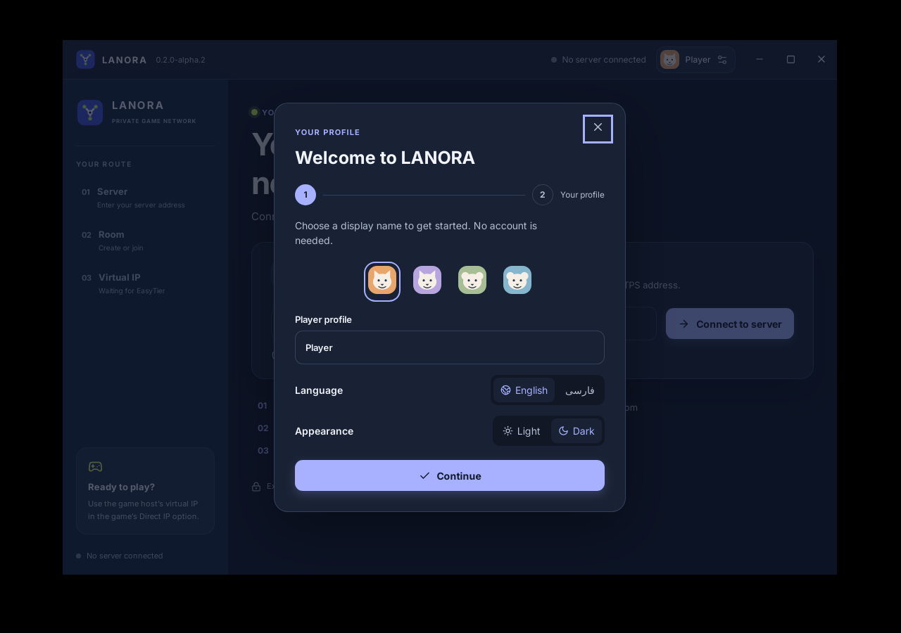

<a href="README.md">English</a> · <a href="README.fa.md">فارسی</a>

# LANORA

**به شبکهٔ بازی دوستان وصل شو، آی‌پی مجازی میزبان را بفرست و بازی کن.**

LANORA برنامه‌ای متن‌باز و خودمیزبان برای بازی‌هایی است که از LAN پشتیبانی می‌کنند. یک نفر سرور را روی VPS لینوکس اجرا می‌کند. بازیکنان برنامهٔ دسکتاپ را نصب و نشانی سرور را وارد می‌کنند. برنامه فقط وقتی رمز بازیکن را می‌پرسد که آن سرور رمز بخواهد. حساب کاربری یا سرویس میزبانی‌شدهٔ LANORA وجود ندارد.

> **نسخهٔ فعلی: <code dir="ltr">0.3.0-alpha.1</code> (پیش‌انتشار آزمایشی).** این انتشار شامل بسته‌های امضاشدهٔ ویندوز و Debian، checksum، امضاهای جداگانه و مانیفست به‌روزرسانی Tauri است. تست‌های رابط/Rust، شبکهٔ ایزولهٔ Linux، API و فرمان‌های VPS، ساخت/نصب/اجرای بسته‌های ویندوز و Linux و تأیید امضای به‌روزرسانی در CI موفق شدند. نسخهٔ `v0.2.0-alpha.8` به‌روزرسانی‌گر ندارد، بنابراین نصب نخستین نسخهٔ دارای به‌روزرسانی‌گر باید دستی انجام شود. به‌روزرسانی و راه‌اندازی دوباره بین دو نصب واقعی، بازی دو ویندوز روی اینترنت عمومی، عبور ترافیک بازی از تونل ویندوز، P2P/NAT traversal و کشف خودکار LAN در بازی‌های مشخص تأیید نشده‌اند.
>
> **هشدار دسترسی:** در سرور بدون رمز، هر کسی که بتواند به سرور دسترسی پیدا کند می‌تواند درخواست عضویت بدهد. تغییر سیاست رمز، نشست‌های API را باطل و هویت شبکه را عوض می‌کند؛ اما نمی‌تواند کلاینت تغییریافته‌ای را که هنوز از شبکهٔ قدیمی EasyTier استفاده می‌کند مجبور به قطع کند. پس از تغییر سیاست از همه بخواهید کامل قطع شوند و دوباره وصل شوند.

   

## تصویر نرم‌افزار

*تصویر واقعی از تست اجرای دسکتاپ لینوکس در یکی از نسخه‌های آلفای قبلی است. ظاهر نسخهٔ فعلی ویندوز ممکن است متفاوت باشد.*

## دانلود LANORA

- **ویندوز ۱۰/۱۱، x64:** [دانلود نصب‌کننده](https://github.com/kavianpcx/LANORA/releases/download/v0.3.0-alpha.1/LANORA_0.3.0-alpha.1_x64-setup.exe) · [SHA-256](https://github.com/kavianpcx/LANORA/releases/download/v0.3.0-alpha.1/LANORA_0.3.0-alpha.1_x64-setup.exe.sha256) · [امضا](https://github.com/kavianpcx/LANORA/releases/download/v0.3.0-alpha.1/LANORA_0.3.0-alpha.1_x64-setup.exe.sig)
- **لینوکس x64، Debian/Ubuntu:** [دانلود بستهٔ .deb](https://github.com/kavianpcx/LANORA/releases/download/v0.3.0-alpha.1/LANORA_0.3.0-alpha.1_amd64.deb) · [SHA-256](https://github.com/kavianpcx/LANORA/releases/download/v0.3.0-alpha.1/LANORA_0.3.0-alpha.1_amd64.deb.sha256) · [امضا](https://github.com/kavianpcx/LANORA/releases/download/v0.3.0-alpha.1/LANORA_0.3.0-alpha.1_amd64.deb.sig)
- [یادداشت انتشار و همهٔ فایل‌ها](https://github.com/kavianpcx/LANORA/releases/tag/v0.3.0-alpha.1) · [مانیفست زندهٔ به‌روزرسانی](https://raw.githubusercontent.com/kavianpcx/LANORA/release/0.2.x/updates/alpha/latest.json)

پیش از نصب، فایل دانلودشده را با فایل SHA-256 کناری آن بررسی کنید.

## اتصال به‌عنوان بازیکن

۱. LANORA را نصب و باز کنید. یک نام نمایشی انتخاب کنید؛ ثبت‌نام لازم نیست.
۲. نشانی HTTPS را از صاحب سرور بگیرید و در برنامه وارد کنید.
۳. **Connect** را بزنید. فقط اگر برنامه رمز خواست، آن را وارد کنید.
۴. وقتی LANORA آی‌پی مجازی شما را نشان داد، آن را برای دوست میزبان بازی بفرستید.
۵. بقیهٔ بازیکنان آی‌پی مجازی میزبان را در بخش Direct IP یا Join by address بازی وارد کنند. نشانی VPS فقط برای اتصال LANORA است.

اگر API روی همین رایانه اجرا می‌شود، برای آزمایش محلی از `http://localhost:8080` یا `http://127.0.0.1:8080` استفاده کنید؛ پورت رابط Tauri/Vite یعنی 1420 پورت API نیست. `localhost` به VPS اشاره نمی‌کند. سرور عمومی باید HTTPS داشته باشد.

کشف خودکار LAN در بازی‌ها متفاوت است. بعضی بازی‌ها به Direct IP نیاز دارند و ممکن است از Broadcast یا Multicast کار نکنند.

## راه‌اندازی سرور شخصی

نسخهٔ فعلی سرور و برنامه از سورس شاخهٔ <code dir="ltr">release/0.2.x</code> استفاده می‌کند. نصب‌کننده API سرور را از همان checkout می‌سازد؛ سرور میزبانی‌شده یا حساب جداگانه‌ای برای دانلود لازم نیست.

به یک VPS لینوکس، دامنه‌ای که به IP عمومی آن اشاره کند، Docker Engine همراه افزونهٔ Compose، Git و OpenSSL نیاز دارید. پورت‌های ورودی TCP **80** و **443** و نیز **11010 با TCP و UDP** را در فایروال VPS و پنل شرکت میزبان باز کنید. پورت API یعنی 8080 باید خصوصی بماند.

این دستورها را در VPS اجرا کنید:

~~~sh
git clone --branch release/0.2.x https://github.com/kavianpcx/LANORA.git
cd LANORA
bash scripts/setup-server.sh
~~~

وقتی اسکریپت دامنه را خواست، آن را وارد کنید. در نصب تازه، این پرسش نمایش داده می‌شود:

~~~text
Require a password for players? [Y/n]:
~~~

برای حفظ گزینهٔ امن پیش‌فرض، Enter یا **Yes** را بزنید. سرویس‌ها شروع می‌شوند و سپس اسکریپت رمز را دو بار می‌پرسد. هنگام تایپ، رمز نمایش داده نمی‌شود:

~~~text
Enter player password:
Confirm player password:
~~~

رمز باید حداقل ۱۲ نویسه داشته باشد و یا ۱۶ نویسه باشد یا دست‌کم از سه نوع نویسه استفاده کند؛ حداکثر اندازه ۱۲۸ بایت است. API فقط Hash از نوع PBKDF2-SHA256 را ذخیره می‌کند، نه متن رمز را. تا پایان تنظیم سیاست، بازیکنان نمی‌توانند وارد شوند.

برای دسترسی بدون رمز **No** را انتخاب کنید. اسکریپت هشدار می‌دهد که هر کسی بتواند به سرور برسد می‌تواند وارد شبکهٔ مشترک بازی شود. این انتخاب فقط به بازیکنان مربوط است؛ احراز هویت مدیر و اعتبارنامه‌های رلهٔ EasyTier جداگانه محافظت می‌شوند.

در پایان، نشانی سرور و سیاست انتخاب‌شده نمایش داده می‌شود. نمونه:

~~~text
Player address (verify HTTPS from another network): https://games.example.com
Player password protection is enabled. Share your chosen password privately.
~~~

در نصب بدون رمز، خط آخر هشدار می‌دهد که هر کسی که به سرور دسترسی دارد می‌تواند وارد شود. نشانی HTTPS را برای بازیکنان بفرستید؛ رمز را فقط وقتی محافظت فعال است خصوصی به اشتراک بگذارید.

برای بررسی وضعیت یا تغییر سیاست در آینده، بدون نصب دوباره:

~~~sh
bash scripts/server.sh status
bash scripts/server.sh player-auth status
bash scripts/server.sh player-auth enable
bash scripts/server.sh player-auth change
bash scripts/server.sh player-auth disable
~~~

نصب‌های موجود، تنظیمات <code dir="ltr">.env</code>، پایگاه داده و سیاست فعلی را نگه می‌دارند؛ راه‌اندازی دوباره سرور را بی‌اجازه به حالت بدون رمز نمی‌برد. مراحل به‌روزرسانی، پرسش‌های نصب و رفتار تغییر سیاست در [راهنمای VPS](docs/SELF_HOSTING.md) آمده است.

## LANORA چطور کار می‌کند؟

API خودمیزبان Go اعلام می‌کند که سرور برای بازیکنان رمز می‌خواهد یا نه و درخواست عضویت را بررسی می‌کند. پس از مجوز واقعی، برای هر دستگاه نشست بازیکن می‌سازد. حالت بدون رمز، رمز بازیکن را حذف می‌کند اما نشست را همچنان می‌سازد؛ مسیرهای مدیر و اعتبارنامه‌های داخلی رلهٔ EasyTier جداگانه محافظت می‌شوند. EasyTier ترافیک بازی را از شبکهٔ مجازی عبور می‌دهد. LANORA دروازهٔ پیش‌فرض اینترنت یا پراکسی سراسری را تغییر نمی‌دهد و API مسیر ترافیک بازی نیست.

## چه چیزهایی آزمایش شده‌اند؟

تست‌های Go API و race، تست‌های رابط و Rust، بررسی استقرار Docker، ساخت/نصب/اجرای نصب‌کنندهٔ ویندوز و ساخت/نصب/اجرای بستهٔ لینوکس در گردش انتشار موفق شدند. در تست ایزولهٔ Linux، دو کلاینت EasyTier ترافیک TCP و UDP را از رله ردوبدل کردند.

این تست‌ها **دو رایانه روی اینترنت‌های جدا، ترافیک بازی در ویندوز، رله روی VPS بیرونی، P2P مستقیم یا بازی مشخصی** را تأیید نمی‌کنند. پیش از استفادهٔ عمومی، [محدودیت‌های تست شبکه](docs/ROADMAP.md) را بخوانید.

## راهنماها

- [شروع سریع](docs/GETTING_STARTED.md)
- [راهنمای کامل VPS، پرسش‌ها و به‌روزرسانی](docs/SELF_HOSTING.md)
- [نصب برنامهٔ دسکتاپ](docs/INSTALLATION.md)
- [نحوهٔ کار شبکه](docs/NETWORKING.md)
- [نکات امنیتی](docs/SECURITY.md)
- [تنظیمات](docs/CONFIGURATION.md)
- [عیب‌یابی](docs/TROUBLESHOOTING.md)
- [ساخت از سورس](docs/BUILDING.md)

## ساختار پروژه

| مسیر | کاربرد |
|---|---|
| apps/desktop | برنامهٔ دسکتاپ Tauri 2، React، TypeScript و Rust |
| services/api | API با Go و ذخیره‌سازی SQLite |
| docker-compose.yml و deploy/docker | API، پراکسی HTTPS و رلهٔ EasyTier برای میزبانی شخصی |
| docs | راهنماهای نصب، شبکه، امنیت و انتشار |

کد LANORA مجوز MIT دارد. EasyTier مجوز جداگانه دارد؛ [اعلان مجوزهای شخص ثالث](THIRD_PARTY_LICENSES.md) را ببینید.
