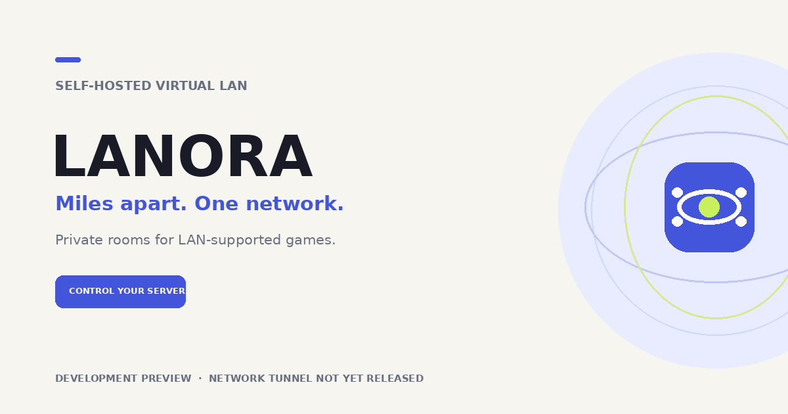

<p align="center"></p>
<p align="center"><strong>دوست‌ها را به یک شبکهٔ خصوصی برای بازی بیاور.</strong></p>
<p align="center"><a href="README.md">English</a> · <a href="README.fa.md">فارسی</a></p>
<p align="center">   <a href="https://github.com/kavianpcx/lanora/actions"></a></p>

LANORA یک پلتفرم متن‌باز و خودمیزبان برای ساخت شبکهٔ مجازی بازی است تا دوستان بتوانند روم خصوصی بسازند و بازی‌های دارای LAN را از طریق اینترنت کنار هم اجرا کنند.

> **وضعیت توسعه:** مدیریت حساب و روم در API و رابط وب پیاده‌سازی شده است. تونل EasyTier در ویندوز، آداپتور مجازی، سنجه‌های همتا، نصب‌کننده و تست واقعی دو رایانه هنوز تکمیل نشده‌اند. این نسخه در حال حاضر شبکهٔ مجازی عملیاتی فراهم نمی‌کند. نصب‌کننده یا GitHub Release منتشر نشده است.

## چه چیزهایی اکنون کار می‌کنند؟

- API واقعی Go و SQLite برای ثبت‌نام، ورود، ویرایش حساب، ساخت و ورود به روم، تأیید عضو، تعویض کد دعوت، حذف عضو، خروج و بستن روم.
- وب‌اپ React با رابط فارسی RTL، پوستهٔ روشن/تیره، حساب کاربری، مدیریت روم، عیب‌یابی API، تنظیمات و صفحهٔ دانلود دسکتاپ با برچسب توسعه.
- Compose برای API، SQLite، وب‌اپ سرو‌شده با Caddy و نسخهٔ ثابت EasyTier `v2.6.4`.
- پوستهٔ دسکتاپ Tauri 2 و اسکلت نظارت Native بر فرایند.
- وضعیت اتصال، IP و Ping ساختگی نیست؛ تا اندازه‌گیری توسط موتور Native با برچسب توسعه/نامشخص می‌مانند.

## تصویر محصول

لوگو و تصویر اجتماعی این مخزن آثار اختصاصی LANORA هستند. تصویر زیر **مفهومی است، نه اسکرین‌شات یک تونل LAN فعال**. پس از اعتبارسنجی برنامهٔ ویندوز، اسکرین‌شات واقعی اضافه می‌شود.

<p align="center"></p>

## شبکهٔ مجازی چطور کار خواهد کرد؟

API خودمیزبان نقش **Control Plane** را دارد: حساب، کد دعوت، عضویت و تأیید را مدیریت می‌کند و بسته‌های بازی را عبور نمی‌دهد. کلاینت Native ویندوز قرار است EasyTier را به‌عنوان Sidecar اجرا کند، رابط مجازی مخصوص روم بسازد و وضعیت واقعی همتا را گزارش دهد. اتصال مستقیم همتا و Relay خودمیزبان در برنامه است. فقط مقصدهای شبکهٔ مجازی باید از رابط مجازی عبور کنند؛ Default Route کاربر نباید عوض شود.

برخی بازی‌ها برای پیدا کردن میزبان به UDP Broadcast، Multicast یا Layer-2 نیاز دارند و ممکن است در شبکهٔ مسیریابی‌شده کار نکنند. نسخهٔ EasyTier `v2.6.4` یک UDP Broadcast Relay اختیاری ویندوزی دارد که به‌طور پیش‌فرض خاموش است و مجوز Administrator می‌خواهد؛ LANORA هنوز آن را تنظیم یا آزمایش نکرده است. اگر بازی Direct IP دارد، آن را امتحان کنید. سازگاری هر بازی باید جداگانه بررسی شود.

## اجرای سریع API و وب

پیش‌نیازها: Go 1.27 یا جدیدتر، Node.js 20 یا جدیدتر و npm. SQLite به‌طور پیش‌فرض در `services/api/data/lanora.db` ذخیره می‌شود.

```sh
cd services/api
go run ./cmd/lanora-api
```

در ترمینال دیگری:

```sh
cd apps/web
npm ci
npm run dev
```

نشانی Vite را باز کنید، حساب بسازید و در صورت نیاز `http://localhost:8080` را در API Base URL تنظیم کنید. برای آزمایش نفر دوم از پروفایل مرورگر دیگری استفاده کنید. [راهنمای شروع](docs/GETTING_STARTED.md)

### ساخت روم

1. وارد حساب شوید و **ساخت روم** را انتخاب کنید.
2. نام، ظرفیت، رمز اختیاری و تأیید میزبان را تنظیم کنید.
3. کد دعوت را به دوستان بدهید.
4. وضعیت روم و عضویت در API ذخیره می‌شود.

### ورود به روم

1. نفر دوم ثبت‌نام کند و وارد شود.
2. کد دعوت و در صورت نیاز رمز را وارد کند.
3. اگر تأیید میزبان فعال است منتظر تأیید بماند.
4. تونل واقعی به کلاینت دسکتاپ ویندوز نیاز دارد و هنوز آماده نیست.

## پیش‌نیاز و Build

| بخش | پیش‌نیاز | وضعیت |
|---|---|---|
| وب | Node.js 20+ و npm | Build تولیدی پیاده‌سازی شده |
| API | Go 1.27+ | تست‌ها نوشته شده‌اند، اما در این محیط اجرا نشدند |
| دسکتاپ | Windows 10/11 x64، Node.js، Rust و پیش‌نیازهای Tauri 2 | پوستهٔ اولیه؛ نصب‌کننده و تونل تأیید نشده |
| Self-Hosting | VPS لینوکس، Docker Compose و DNS | زیرساخت Compose؛ Deployment اینجا اجرا نشده |

[راهنمای ساخت](docs/BUILDING.md) و [نصب](docs/INSTALLATION.md).

## اجرای Self-Hosted

```sh
cp .env.example .env
# دامنه و تمام Secretهای نمونه را تغییر دهید
docker compose config
docker compose up -d --build
curl --fail https://YOUR_HOST/api/v1/health
```

Caddy TLS را خاتمه می‌دهد، Frontend ساخته‌شده را سرو می‌کند و مسیر `/api/*` را به API می‌فرستد؛ SQLite در Volume پایدار می‌ماند. کانتینر EasyTier زیرساخت اولیه است و هنوز Relay عملیاتی هر روم نیست. GitHub Pages راه جایگزین برای میزبانی Frontend ایستا است؛ API و پایگاه‌داده و Relay باید خودمیزبان باشند. راهنماها: [Self-Hosting](docs/SELF_HOSTING.md)، [Deployment](docs/DEPLOYMENT.md).

## فناوری‌ها

Tauri 2، Rust، React، TypeScript، Vite، Tailwind CSS، Zustand، Go، SQLite، WebSocket، Docker Compose، Caddy و EasyTier.

## ساختار مخزن

```text
apps/desktop/       پوستهٔ Tauri ویندوز
apps/web/           وب‌اپ React و Frontend برای Pages
apps/admin/         وضعیت پنل مدیریت (رابط هنوز پیاده‌سازی نشده)
services/api/       API و Migrationهای Go
services/network/   وضعیت/اسکلت Native Networking
deploy/docker/      Dockerfile API و تنظیمات Caddy
docs/               راهنماهای معماری، اجرا، API، امنیت و Build
tests/              ماتریس و طرح تست شبکه
assets/             لوگوها و تصویر اجتماعی اختصاصی
```

## مستندات

- [شروع](docs/GETTING_STARTED.md) · [نصب](docs/INSTALLATION.md) · [Build](docs/BUILDING.md)
- [Self-Hosting](docs/SELF_HOSTING.md) · [Deployment](docs/DEPLOYMENT.md) · [تنظیمات](docs/CONFIGURATION.md)
- [معماری](docs/ARCHITECTURE.md) · [شبکه](docs/NETWORKING.md) · [API](docs/API.md)
- [امنیت](docs/SECURITY.md) · [عیب‌یابی](docs/TROUBLESHOOTING.md) · [پرسش‌ها](docs/FAQ.md) · [Roadmap](docs/ROADMAP.md)
- [مجوزهای وابستگی‌ها](THIRD_PARTY_LICENSES.md) · [ماتریس تست شبکه](tests/NETWORK_TEST_MATRIX.md) · [تنظیمات Repository در GitHub](docs/GITHUB_REPOSITORY_SETUP.md)

## محدودیت‌ها

- EasyTier به کلاینت ویندوز وصل نیست؛ IP مجازی و انتقال بازی وجود ندارد.
- NAT/P2P/Relay/TCP/UDP/Discovery با دو رایانهٔ ویندوزی تست نشده است.
- توکن حساب و روم جدا هستند و عضویت روم به حساب وصل است؛ تأیید ایمیل و بازیابی حساب وجود ندارد.
- WebSocket و Rate Limit در حافظهٔ همان فرایند هستند؛ پنل وب مدیریت وجود ندارد.
- رابط وب فعلاً فقط فارسی است؛ ترجمهٔ کامل انگلیسی باقی مانده است.
- نصب‌کنندهٔ امضاشده، Binary Release، SBOM کامل و Deployment تولیدی تأییدشده وجود ندارد.

## مشارکت و مجوز

برای مشارکت [CONTRIBUTING.md](CONTRIBUTING.md) را بخوانید و فقط نتایج تستی را بنویسید که واقعاً اجرا شده‌اند. گزارش آسیب‌پذیری باید خصوصی و از GitHub Security Advisory باشد؛ جزئیات در [SECURITY.md](SECURITY.md) است.

کد اصلی LANORA تحت MIT است. وابستگی‌های ثالث مجوز خودشان را حفظ می‌کنند؛ EasyTier تحت LGPL-3.0 است و در این نسخه بسته‌بندی نشده. [LICENSE](LICENSE) و [THIRD_PARTY_LICENSES.md](THIRD_PARTY_LICENSES.md) را ببینید.
