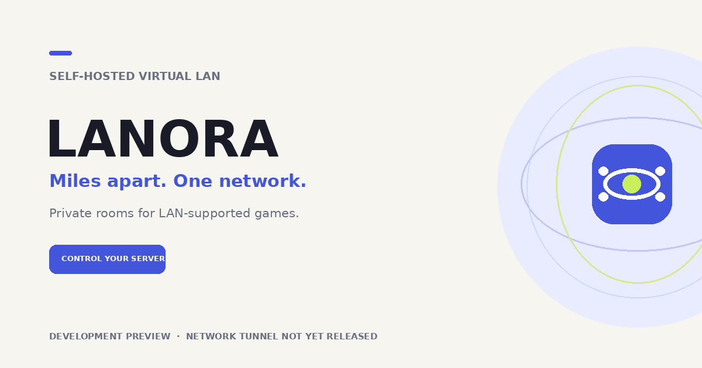

<p align="center"></p>
<p align="center"><strong>Bring your friends into the same private game network.</strong></p>
<p align="center"><a href="README.fa.md">فارسی</a> · <a href="README.md">English</a></p>
<p align="center">   <a href="https://github.com/kavianpcx/lanora/actions"></a></p>

LANORA is an open-source, self-hosted virtual LAN gaming platform that lets friends create private rooms and play LAN-supported games together over the internet.

> **Development status:** account/room control-plane flows and the web interface call the Go API. The Windows EasyTier tunnel, virtual adapter, peer metrics, installer, and real two-computer game tests are not complete. This source snapshot does not provide a working virtual LAN. No installer or GitHub Release has been published.

## What works today

- Go REST API backed by SQLite for registration, login, profile updates, room creation/join, approval, invite rotation, member removal, leave and close.
- React web app with Persian RTL UI, light/dark themes, account and room flows, API diagnostics, settings, and a development-labeled desktop download page.
- Self-hosted API, SQLite, Caddy-served web frontend, and an EasyTier `v2.6.4` container pin in Compose.
- Tauri 2 desktop shell and Rust process-supervision scaffold.
- Tunnel status, virtual IP and ping are never fabricated; they remain Development/unknown until measured by a native engine.

## Product artwork

The repository includes original LANORA branding. This is a **concept illustration, not a screenshot of a running LAN tunnel**. A real product screenshot will be added after Windows UI and networking validation.

<p align="center"></p>

## How Virtual LAN is intended to work

The self-hosted API is the **control plane** for accounts, invite codes, room membership and approval. It does not proxy game packets. A native Windows client is intended to run EasyTier as a sidecar, create a room-scoped virtual interface, and report actual peer state. Direct peer connectivity and a self-hosted relay are planned. The client must route only virtual-network destinations and must not replace the user's default route.

Some LAN games rely on UDP broadcast, multicast, or Layer-2 discovery and may not work on a routed overlay. EasyTier `v2.6.4` documents an optional Windows UDP broadcast relay (off by default, requires administrator privileges), but LANORA does not configure or test it. Use a game's Direct IP option when available. Compatibility is game-specific and unverified.

## Quick start: API + web

Requirements: Go 1.27+, Node.js 20+, npm. SQLite defaults to `services/api/data/lanora.db`.

```sh
cd services/api
go run ./cmd/lanora-api
```

In a second terminal:

```sh
cd apps/web
npm ci
npm run dev
```

Open the Vite URL, register, and set API Base URL to `http://localhost:8080` if needed. In a second browser profile, register another account and join with the host's invite code. See [Getting Started](docs/GETTING_STARTED.md).

### Create a room

1. Sign in and choose **Create Room**.
2. Set the name, capacity, optional password and approval setting.
3. Share the generated invite code.
4. Room state and membership are stored in the connected API.

### Join a room

1. Sign in on the second client and choose **Join Room**.
2. Enter the invite code and password if required.
3. If approval is enabled, wait for the host.
4. A real tunnel requires the Windows desktop client, whose network integration is not ready.

## Prerequisites and builds

| Component | Requirements | Current state |
|---|---|---|
| Web | Node.js 20+, npm | Production build implemented |
| API | Go 1.27+ | Tests authored; not run in this environment |
| Windows desktop | Windows 10/11 x64, Node.js, Rust, Tauri v2 prerequisites | Shell scaffold; installer/tunnel unverified |
| Self-hosting | Linux VPS, Docker Compose, DNS | Compose foundation; deployment not verified here |

See [BUILDING](docs/BUILDING.md) and [INSTALLATION](docs/INSTALLATION.md).

## Self-hosting

```sh
cp .env.example .env
# Edit hostname and replace every example secret
docker compose config
docker compose up -d --build
curl --fail https://YOUR_HOST/api/v1/health
```

Caddy terminates TLS, serves the built web frontend, and proxies `/api/*` to the API; SQLite persists in a Docker volume. The EasyTier container is infrastructure groundwork, not a functional per-room relay. GitHub Pages is an alternative static frontend host; API, database and relay remain self-hosted. See [SELF_HOSTING](docs/SELF_HOSTING.md) and [DEPLOYMENT](docs/DEPLOYMENT.md).

## Technology

Tauri 2, Rust, React, TypeScript, Vite, Tailwind CSS, Zustand, Go, SQLite, WebSocket, Docker Compose, Caddy and EasyTier.

## Repository layout

```text
apps/desktop/       Tauri Windows client shell
apps/web/           React web app and GitHub Pages frontend
apps/admin/         Admin UI status (web UI not implemented)
services/api/       Go control-plane API and migrations
services/network/   Native networking status/scaffold
deploy/docker/      API image and Caddy configuration
docs/               Architecture, operation, API, security and build guides
tests/              Network verification matrix and test plans
assets/             Original LANORA vector marks and social artwork
```

## Documentation

- [Getting started](docs/GETTING_STARTED.md) · [Installation](docs/INSTALLATION.md) · [Building](docs/BUILDING.md)
- [Self-hosting](docs/SELF_HOSTING.md) · [Deployment](docs/DEPLOYMENT.md) · [Configuration](docs/CONFIGURATION.md)
- [Architecture](docs/ARCHITECTURE.md) · [Networking](docs/NETWORKING.md) · [API](docs/API.md)
- [Security](docs/SECURITY.md) · [Troubleshooting](docs/TROUBLESHOOTING.md) · [FAQ](docs/FAQ.md) · [Roadmap](docs/ROADMAP.md)
- [Third-party licenses](THIRD_PARTY_LICENSES.md) · [Network test matrix](tests/NETWORK_TEST_MATRIX.md) · [GitHub repository settings](docs/GITHUB_REPOSITORY_SETUP.md)

## Known limitations

- EasyTier is not integrated into the Windows client; virtual IP and game traffic are unavailable.
- No two-PC NAT/P2P/relay/TCP/UDP/discovery test has been verified.
- Account and room tokens are distinct, while each room membership is linked to its account; email verification/recovery are absent.
- WebSocket events and rate limits are process-local; no admin web interface exists yet.
- The web interface currently ships in Persian; complete English localization is still pending.
- No signed Windows installer, binary release, complete transitive SBOM, or verified production deployment exists.

## Roadmap

See [ROADMAP](docs/ROADMAP.md). The next milestone is a real, least-privilege Windows network-engine lifecycle followed by two-client validation, not simulated connection UI.

## Contributing

Read [CONTRIBUTING.md](CONTRIBUTING.md), use the issue templates, and keep tunnel claims tied to tests that actually ran. Report vulnerabilities privately through GitHub Security Advisories; see [SECURITY.md](SECURITY.md).

## License

Original LANORA code is offered under MIT. Third-party software retains its own license. EasyTier is LGPL-3.0 and is not bundled in this snapshot. See [LICENSE](LICENSE) and [THIRD_PARTY_LICENSES.md](THIRD_PARTY_LICENSES.md).
