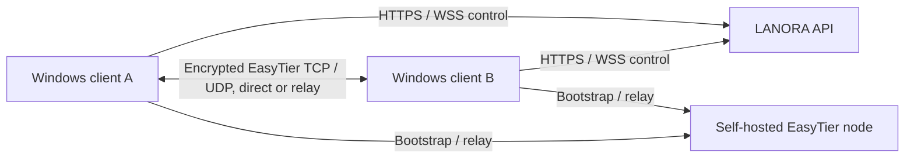

# Network architecture

LANORA separates control plane from game traffic. The Go API owns rooms, invite verification, member admission and event notifications. It must not proxy gameplay packets. A future per-room EasyTier network should carry virtual network traffic directly when NAT traversal succeeds and use an operator-managed relay with the same room network identity as fallback. The diagram below is target topology, not current runtime behavior.

The repository pins EasyTier `v2.6.4`, the latest stable tag observed on 2026-11-15. The upstream README documents TCP/UDP virtual networking, P2P NAT traversal and relay fallback. It also recommends the same network name and secret for peers. LANORA must derive a unique network name and cryptographically random secret per room; invite codes are lookup credentials and are not network secrets.

EasyTier v2.6.4 has an optional Windows UDP broadcast relay feature (disabled by default and requiring administrator privileges), which may help some LAN-discovery games. LANORA does not enable or manage this feature yet. The current Compose EasyTier node uses its own fixed network identity and is isolated from room networks; it is not a functional relay for LANORA rooms. The desktop native code is a process-supervision scaffold, not a production adapter. No virtual IP allocation, authoritative peer-state parsing, firewall rule lifecycle, per-room relay lifecycle, health supervision or Windows service integration is complete yet. This repository therefore does not report a connected tunnel. EasyTier's CLI/config interface and exact Windows release packaging must be validated against the selected asset before shipping.

Games using direct IP over TCP/UDP should work after a verified tunnel exists. UDP broadcast/multicast discovery depends on game behavior and EasyTier configuration. Use the host's virtual IP with the game's Direct IP option as the first compatibility path. Do not change the user's default route or enable exit-node behavior for room traffic.

## Trust boundaries

- API responses are structured values; never execute server-provided commands.
- Room credentials are scoped to a single room. The API stores hashes of invite and bearer tokens.
- Network secrets are generated from OS cryptographic randomness. Production delivery must be TLS-only and excluded from logs/telemetry.
- WebSocket events contain membership state only and never carry secrets.
- Relay traffic is data plane traffic; API availability is not required for already-established peer traffic, but membership changes require the API.
